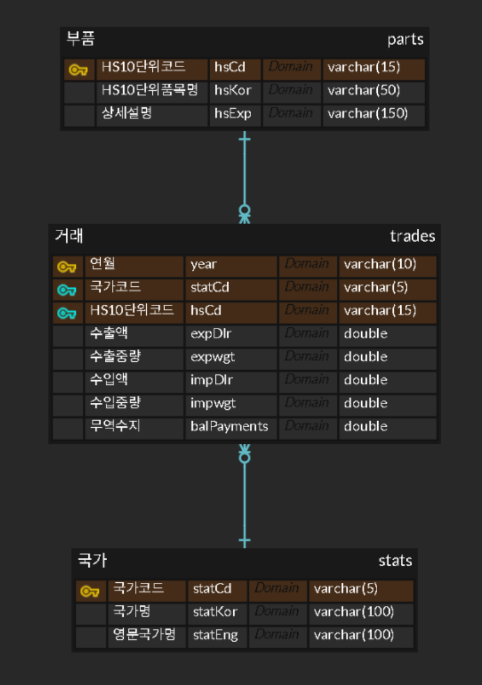
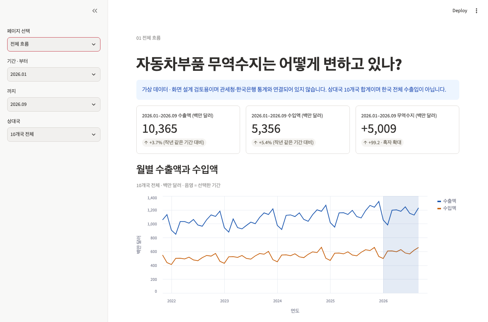
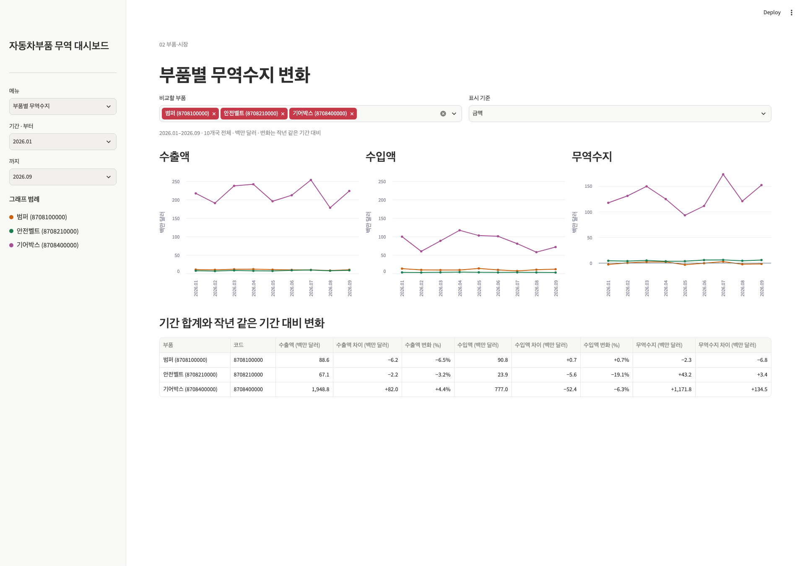
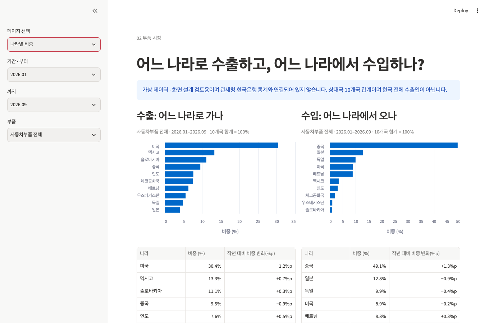
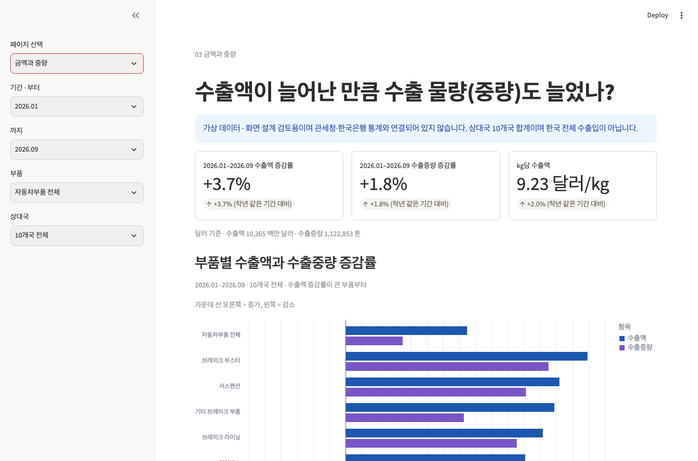
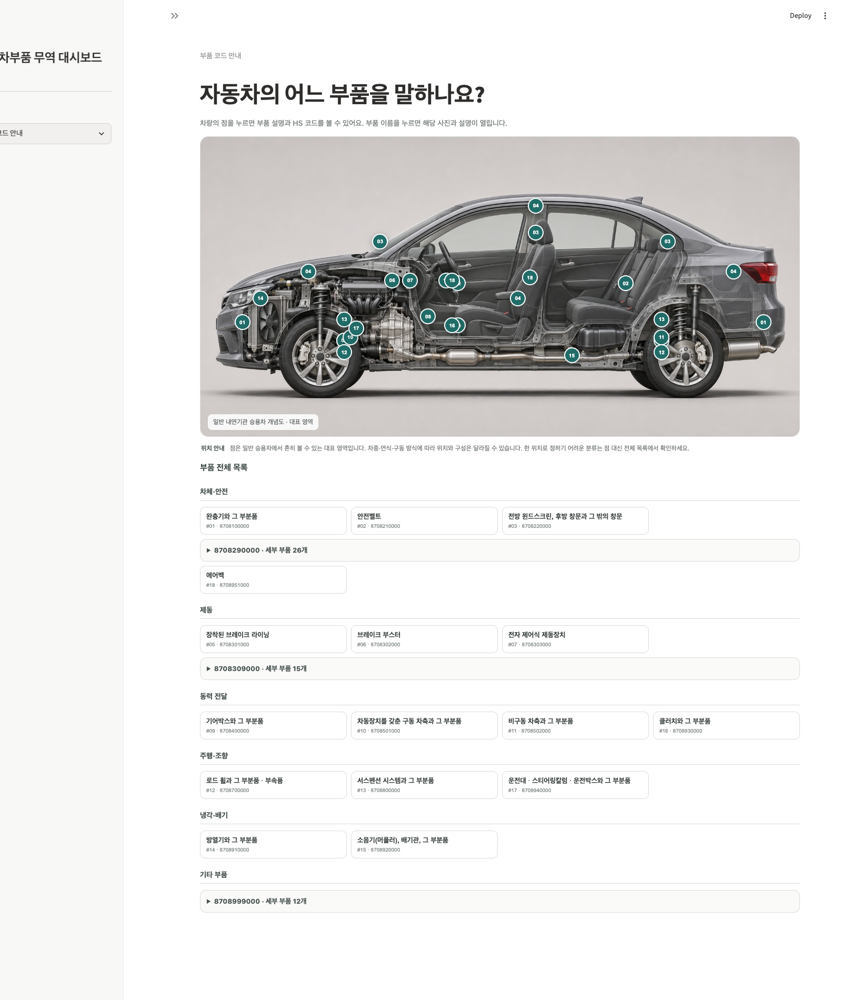

# 🚗 Trade Flow — HS 8708 자동차부품 무역 대시보드

> 한국 자동차 부품은 어디에 얼마나 팔리고, 어떤 부품의 무역수지가 바뀌고 있을까?

<br>

## 1. 팀 소개

**팀명 : SKN38-1st-3Team**

| 이름 | 역할 | GitHub |
| :---: | :--- | :--- |
| 최재헌 | 기획(문제 정의) · 발표자료 제작 · 프런트엔드 | |
| 도연희 | 프런트엔드(디자인, 시각화) | |
| 노지훈 | DB 설계 · 데이터 분석 · 백엔드(데이터 파이프라인) | |
| 송건경 | DB 설계 · 데이터 분석 · 데이터 수집·정제 | |
| 이용의 | 데이터 수집·정제 · 백엔드(데이터 파이프라인) | |

<br>

## 2. 프로젝트 개요

- **프로젝트 명** : Trade Flow (임시)
- **프로젝트 소개** : 관세청 통관자료로 HS 8708 자동차 부품의 수출입 흐름을 품목·상대국·중량 기준으로 비교해, 무역수지가 어디에서 어떻게 바뀌었는지 한눈에 보여주는 대시보드입니다.
- **프로젝트 필요성 (배경)**
  - **완성차 중심 분석의 한계** : 자동차 산업 통계는 대부분 완성차 수출 실적에 맞춰져 있어, 품목마다 경쟁력과 공급망이 다른 부품의 변화를 보기 어렵습니다.
  - **금액 비교의 한계** : 수출액이 늘어도 물량이 늘었다고 볼 수는 없습니다. 가격이나 품목 구성이 달라졌을 수 있어 중량과 단가 대용치를 함께 봐야 합니다.
  - **데이터 활용의 어려움** : 관세청 통계를 조건별로 찾아 비교하려면 시간이 많이 듭니다. 월별 변화, 국가별 비중, 품목별 무역수지를 한곳에서 비교할 화면이 필요합니다.
- **프로젝트 목표**
  - 품목별 무역수지 변화와 흑자·적자 전환 확인
  - 수출 금액과 실제 물량(중량) 비교
  - kg당 금액으로 부품별 평균 단가 대용치 변화 확인
  - 상대국별 수출입 비중 확인
  - 처음 보는 사람도 바로 이해할 수 있는 대시보드 구현

> 현재 저장소의 화면은 **가상 데이터**로 동작합니다. 실제 데이터는 DB 연결 후 반영됩니다.

### 🛠 사용 기술

| 구분 | 기술 |
| :---: | :--- |
| 언어 |  |
| 데이터 수집 | 관세청 OpenAPI (공공데이터포털) |
| 데이터 처리 |  |
| 시각화 / 웹 |  · `Altair` |
| 환경 관리 | `uv` · `.env` 기반 DB·API 키 분리 |

<br>

## 3. 데이터 수집 방법

| 데이터셋 | 출처 | 수집 방식 | 적재 테이블 |
| :--- | :--- | :--- | :--- |
| 품목·국가별 수출입 실적 | [관세청 품목별 국가별 수출입실적](https://www.data.go.kr/data/15100475/openapi.do) | OpenAPI | `trades`, `stats` |
| HS 코드와 품목명 | 관세청 HS 코드 참고자료 | 공공데이터 파일 | `parts` |
| 부품 코드 설명 | 관세청 CLIP 세번표 · WCO HS 2022 · 국가법령정보센터 관세율표 · 자동차 부품 HS 표준해석 지침 | 문서 조사 | 화면 상수 |

- **수집 범위** : 2021.11 ~ 2026.09 월별, HS 8708 10단위 코드 25개, 상대국 10개국(US, CN, MX, SK, CZ, IN, UZ, JP, DE, VN). 화면에서 선택할 수 있는 시작 월은 작년 같은 기간 비교를 위해 2022.11부터입니다.
- **API 조건** : 월 단위 조회이며 한 요청의 기간은 1년 이내입니다.
- **금액과 중량** : 금액은 달러(수출 FOB, 수입 CIF), 중량은 kg(순중량)입니다.
- **주의** : 관세청이 매월 신고 정정 내용을 반영하므로 최근 달은 바뀔 수 있습니다. 합계는 상대국 10개국의 합이며 한국 전체 수출입이 아닙니다.

**데이터 흐름** : API 수집 → 컬럼·코드 정규화 → 중복·누락·산식 검사 → DB 적재 → 분석 집계 → Streamlit

| 수집 파일 열 | ERD 열 | 비고 |
| :--- | :--- | :--- |
| `hsNameKor` | `parts.hsKor` | 공식 품명 |
| `statCdCntnKor1` | `stats.statKor` | 국가명. 파일의 `statKor` 열은 품명이므로 쓰지 않습니다. |
| `expWgt`, `impWgt` | `trades.expwgt`, `trades.impwgt` | 대소문자 표기만 다릅니다. |

<br>

## 4. DB 설계 (ERD)



| 테이블 | 설명 | 키 |
| :--- | :--- | :--- |
| `parts` | 부품. HS 10단위 코드, 품목명, 상세설명 | PK: `hsCd` |
| `stats` | 국가. 국가코드, 국가명, 영문 국가명 | PK: `statCd` |
| `trades` | 거래. 월 × 국가 × HS 코드별 수출입 금액·중량·무역수지 | PK: `year` + `statCd` + `hsCd` |

> 화면에서는 25개 코드를 부품 20개(개별 19개 + 나머지 6개를 합친 기타)로 묶어 보여줍니다. 표시 단위인 백만 달러와 톤으로 바꾸는 곳은 [`utils/data.py`](utils/data.py)의 `load_dashboard_data()`뿐입니다.

<br>

## 5. 주요 기능

> 왼쪽 메뉴에서 페이지를 고릅니다. 네 분석 페이지의 공통 기간은 사이드바에서 선택합니다. 시작 월과 끝 월을 포함해 최대 12개월이며, 선택 범위를 넘기면 끝 월이 시작 월부터 12개월째로 자동 조정됩니다. 페이지별 필터는 각 페이지 제목 아래 한 줄에 표시됩니다. 국가 선택 메뉴와 나라별 비중 그래프에는 국가명과 국기를 함께 표시합니다.

전체 흐름·부품별 무역수지·금액과 중량은 작년 같은 기간과 비교합니다. 나라별 비중은 선택한 기간의 첫 달과 마지막 달 비중 차이를 퍼센트포인트(%p)로 보여줍니다.

### 5-1. 전체 흐름 `views/trend.py`
- 지표 카드 3종 (수출액, 수입액, 무역수지), 작년 같은 기간 대비 변화
- 월별 수출액·수입액 선 그래프, 선택한 기간 음영 표시
- 해마다 같은 기간의 무역수지 막대 그래프
- 페이지 필터 : 대상 국가

### 5-2. 부품별 무역수지 `views/parts.py`
- 부품 20개의 수출액·수입액·무역수지 표, 무역수지가 많이 나빠진 순으로 정렬
- 흑자 확대·축소, 적자 확대·축소, 흑자·적자 전환 상태 표시
- 작년 대비 무역수지 변화 막대 그래프
- 페이지 필터 : 상대국

### 5-3. 나라별 비중 `views/markets.py`
- 수출과 수입의 상대국 비중을 나란히 비교 (10개국 합계 = 100%)
- 선택 기간의 첫 달과 마지막 달 사이 국가별 비중 변화(%p) 그래프와 표
- 페이지 필터 : 부품, 표시 기준(금액·물량)

### 5-4. 금액과 중량 `views/volume.py`
- 지표 카드 3종 (수출액 증감률, 수출중량 증감률, kg당 수출액), 작년 같은 기간 대비 변화
- 부품별 수출액·수출중량 증감률 비교 막대 그래프
- kg당 금액 증감률 표. kg당 금액은 판매 가격이 아닌 대용치입니다.
- 페이지 필터 : 부품, 상대국

### 5-5. 부품 코드 안내 `views/codes.py`
- 자동차 그림의 위치 표시와 부품별 상세 모달
- 실제 부품 사진 우선 표시, 사진이 없는 경우 생성 이미지 사용
- 여러 부품이 묶인 잔여 코드는 목록을 접어 볼 수 있고, 모달 안에서 사진을 넘길 수 있음

### 5-6. FAQ · 용어 안내 `views/faq.py`
- 수치와 무역 용어, 계산 방법
- HS 코드 읽는 방법
- 화면 필터와 그래프, 데이터 범위 안내

<br>

## 6. 실행 방법

```bash
# 1) 대시보드 실행 (Python 3.12, 패키지 자동 설치)
uv run --python 3.12 --with-requirements requirements.txt streamlit run app.py

# 2) (DB 연결 시) 환경변수 설정 — .env.example을 복사해 값을 입력
cp .env.example .env
```

> DB가 없어도 가상 데이터로 화면을 확인할 수 있습니다. 실제 데이터는 [`utils/data.py`](utils/data.py)의 `load_parts`, `load_stats`, `load_trades` 세 함수를 교체하면 연결됩니다. Streamlit 앱의 접속 정보는 `st.secrets`로 읽습니다.
>
> Streamlit Community Cloud의 **Main file path**는 `app.py`입니다.

### 디렉토리 구조

```
SKN38-1st-3Team/
├── app.py                  ← 페이지 설정과 왼쪽 메뉴
├── requirements.txt        ← 앱 실행에 필요한 패키지
├── .env.example            ← 환경변수 템플릿
├── .gitignore
├── README.md
├── views/                  ← 페이지당 한 파일
│   ├── trend.py            ← 전체 흐름
│   ├── parts.py            ← 부품별 무역수지
│   ├── markets.py          ← 나라별 비중
│   ├── volume.py           ← 금액과 중량
│   ├── codes.py            ← 부품 코드 안내
│   └── faq.py              ← FAQ·용어 안내
├── utils/
│   ├── parts_catalog.py    ← 부품별 화면 이름, 공식 HS 품명, 설명, 위치, 이미지 정보
│   ├── constants.py        ← 10개국 목록, 기간, 용어
│   ├── data.py             ← ERD 표 불러오기 (지금은 가상 데이터)
│   └── common.py           ← 필터, 기간 집계, 증감률, 숫자 표시 형식
└── docs/images/            ← ERD, 화면 캡처
```

부품 위치 시각화 전 검토 목록은 [`docs/component-locations.md`](docs/component-locations.md)입니다.

<br>

## 7. 수행 화면 캡처

> 아래 화면의 숫자는 가상 데이터입니다.

### 7-1. 전체 흐름
월별 수출입 흐름과 해마다 같은 기간의 무역수지를 보여주는 화면.



### 7-2. 부품별 무역수지
어느 부품의 무역수지가 나빠지거나 좋아졌는지 비교하는 화면.



### 7-3. 나라별 비중
수출과 수입의 상대국 비중을 비교하는 화면.



### 7-4. 금액과 중량
수출액과 수출중량이 함께 움직였는지 비교하는 화면.



### 7-5. 부품 코드 안내
HS 코드별로 어떤 부품인지 설명하는 화면. 부품 이미지는 준비 중입니다.



<br>

## 8. 회고

**최재헌**
> 작성 예정

**도연희**
> 작성 예정

**노지훈**
> 작성 예정

**송건경**
> 작성 예정

**이용의**
> 작성 예정
